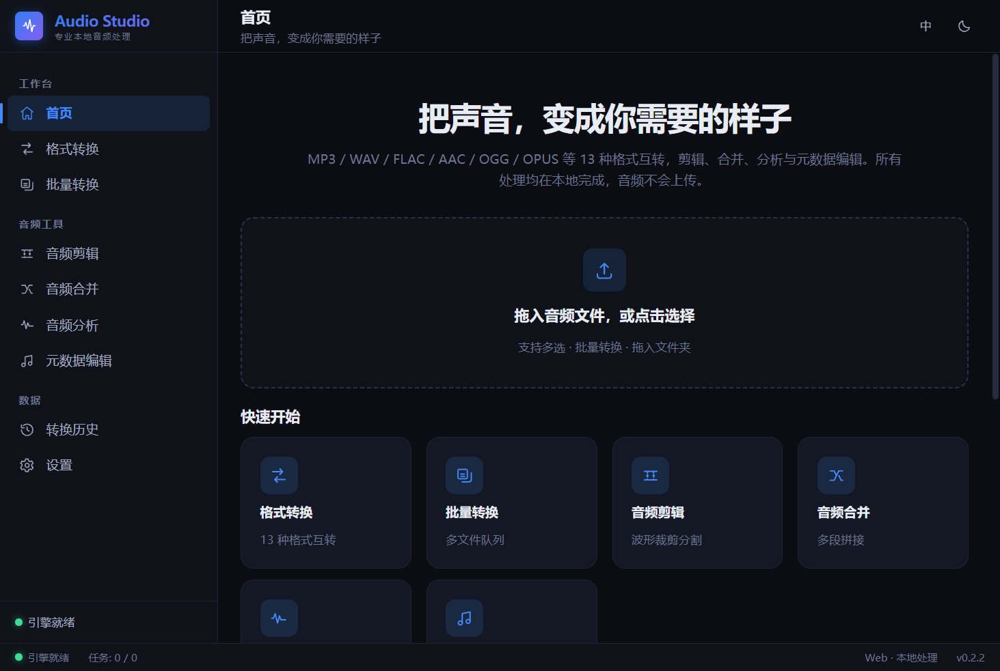
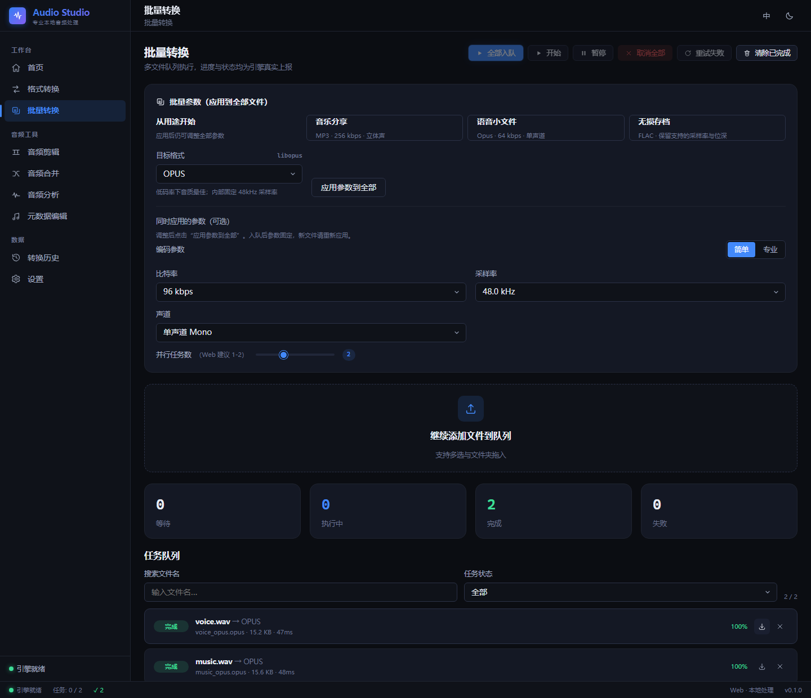

# Audio Studio

[](https://github.com/yuchen0x1/Audio-Studio/actions/workflows/ci.yml)
[](https://github.com/yuchen0x1/Audio-Studio/actions/workflows/release.yml)

专业音频转换工具，提供 **Windows 电脑版和网页版**，两端复用共享核心逻辑与 React 界面。

提供 13 种格式的参数配置、批量处理、无损剪辑、合并、元数据与封面编辑，以及频谱/响度分析。可用的输入和输出格式取决于运行时引擎能力。Web 端基于 FFmpeg.wasm，Windows 电脑版调用本地原生 FFmpeg。

[下载最新稳定版](https://github.com/yuchen0x1/Audio-Studio/releases/latest) · [平台与功能对照](docs/PLATFORMS.md) · [反馈问题](https://github.com/yuchen0x1/Audio-Studio/issues/new/choose)



---

## 功能

| 模块 | 说明 |
|---|---|
| 格式转换 | 单文件转换，实时进度、剩余时间、日志输出 |
| 批量转换 | 目录/多选导入，用途预设、可编辑参数、队列搜索/状态筛选、失败重试（Web/桌面 UI） |
| 音频剪辑 | 无损截取（`-c copy` 优先），自动回退重编码 |
| 音频合并 | 多段拼接，支持淡入淡出、逐段时长探测 |
| 音频分析 | 流信息、元数据、封面、警告项检测 |
| 元数据编辑 | 标题/艺术家/专辑/年份/流派/注释与封面图读写 |
| 转换历史 | 本地持久化任务记录，可复用参数 |
| 设置 | 默认格式、比特率、采样率、输出命名规则、并发数、主题、语言 |

**支持格式**：MP3、WAV、FLAC、AAC、M4A、OGG Vorbis、Opus、WMA、AIFF、APE、AC3、AMR-NB、ALAC

**界面**：简体中文 / English 双语，浅色与深色主题。

---

## 技术栈

| 层 | 技术 |
|---|---|
| 共享核心 | TypeScript（纯逻辑，零运行时依赖），格式化参数、命名规则、任务状态机、错误码、能力矩阵、校验规则 |
| Web | React 18 + Vite 6 + Zustand + FFmpeg.wasm 0.12（单线程内核的实例池、IndexedDB 历史） |
| Windows 桌面 | Tauri 2 + Rust，原生 FFmpeg 进程调用，Windows 通知与文件对话框 |

Web 前端同时作为桌面版 UI（`vite build --mode desktop`）。两端共用 TypeScript 参数核心和 React 界面，分别调用浏览器 wasm 与 Windows 原生音频引擎。

---

## 目录结构

```
.
├── apps/
│   ├── web/                    # React 前端（Web 版 + 桌面版 UI）
│   │   ├── src/engine/         # 引擎抽象：WasmFfmpegEngine / NativeEngine
│   │   ├── src/pages/          # 9 个功能页
│   │   ├── src/stores/         # Zustand：session / settings / history
│   │   └── scripts/            # postinstall 复制 FFmpeg 内核到 public/ffmpeg
│   └── desktop/src-tauri/      # Rust 后端：进程管理、进度解析、文件系统
├── packages/
│   └── shared/                 # 两端共享核心逻辑与单元测试
├── pnpm-workspace.yaml
└── package.json
```

---

## 快速开始

需要 **Node.js ≥ 22.13** 与 **pnpm 11**（仓库锁定 `pnpm@11.20.0`）。

```bash
pnpm install          # 会自动把 FFmpeg.wasm 内核复制到 apps/web/public/ffmpeg
pnpm dev              # 启动 Web 开发服务器（http://localhost:5180）
```

> `apps/web/public/ffmpeg/` 是 `postinstall` 生成的产物（约 32 MB），不入版本库。

### 常用命令

```bash
pnpm typecheck        # 全量 TypeScript 类型检查
pnpm lint             # ESLint（TS/TSX + 构建脚本）
pnpm format:check     # Prettier 格式检查（pnpm format 自动修复）
pnpm test             # shared + web 单元测试
pnpm test:coverage    # 带 v8 覆盖率（输出 lcov + html）
pnpm build:web        # 构建 Web 产物到 apps/web/dist

# 桌面版（需稳定版 Rust、MSVC 和 WebView2）
pnpm build:desktop-ui
cargo run --manifest-path apps/desktop/src-tauri/Cargo.toml

```

### 桌面版依赖

桌面端调用系统 FFmpeg，需要保证 `ffmpeg`/`ffprobe` 在 `PATH` 中，或放在应用同目录下。

### 安装或部署

- **Windows x64** 从 [稳定版下载](https://github.com/yuchen0x1/Audio-Studio/releases/latest) 选择 NSIS EXE 或 MSI。启动后可在设置中检查 FFmpeg 和应用更新。
- **Web / PWA** 解压 v0.2.3 起的 Web ZIP，在目录中运行 `node prepare-ffmpeg.mjs`。此步骤需要 Node.js、`tar` 和至 npm 官方注册表的网络连接。脚本核对 FFmpeg.wasm 包的 SHA-512 后准备两个引擎文件。用 HTTPS 静态服务发布整个目录，开发验收可用 localhost。PWA 支持时可通过浏览器菜单安装。
- **引擎未就绪** 检查两个 `ffmpeg/` 文件是否部署到与页面同源的路径，确认服务器为 WASM 返回 `application/wasm`。Windows 版可在设置中核对本地 FFmpeg 路径和编码器能力。
- **更新与文件恢复** 见 [自动更新说明](docs/AUTO_UPDATE.md)。开始更新前先完成任务并下载结果，历史记录可导出为 JSON。

---

## 测试

| 范围 | 用例数 | 命令 |
|---|---|---|
| 共享核心 | 101（含 20 项需系统 FFmpeg/FFprobe 的条件集成测试） | `pnpm --filter @audio-studio/shared test` |
| Web | 137 | `pnpm --filter @audio-studio/web test` |
| Rust | 47 | `cargo test --manifest-path apps/desktop/src-tauri/Cargo.toml --locked` |
| 发布日志提取 | 5 | `pnpm test:release-notes` |

测试使用包内临时目录并串行执行，避免并发写缓存导致的偶发失败。`pnpm test:coverage` 可生成 v8 覆盖率（lcov + html）；本轮未重新生成覆盖率报告，不沿用旧百分比作为当前结果。

### 用途预设与批量工作流（Web / Windows UI）

单文件参数弹窗和批量页提供音乐分享（MP3 256 kbps）、语音小文件（Opus 64 kbps / 48 kHz / 单声道）、无损存档（FLAC）三种预设。预设不启用归一化或额外音效；可以继续修改参数。FLAC 保留支持的源位深，未知或超出支持范围时使用 24-bit；从有损源转存不会恢复已损失的音质。

预设按钮会应用到当前已导入文件。手动调整批量参数后，点击“应用参数到全部”；后续新导入文件需要重新应用。任务在入队时保存参数快照，后续编辑不改变正在执行、等待或暂停的任务。需要用新参数重做时，先清除已完成任务，再重新入队。

队列支持按文件名搜索与状态筛选。筛选只影响显示，上方暂停、取消、重试等批量操作仍作用于整个队列。



### 浏览器真实音频验收

需要 Python 3.14（或修改启动命令使用其他已安装的 Python）及 Playwright Python 包和 Chromium。这是可选开发工具，不是应用运行依赖。在两个终端中分别运行：

```powershell
pnpm --filter @audio-studio/web dev --host 127.0.0.1 --port 5187 --strictPort
py -3.14 apps/web/scripts/e2e-audio.py
```

脚本生成合成音频，实际操作转换、预设、下载、搜索/筛选、主题、窄屏导航和历史刷新；检查 MP3/Opus/FLAC 文件、合并间隔和淡出。测试产物位于 `.vitest-tmp/e2e-audio/`，实际截图写入 `docs/screenshots/`。详见 [本轮升级与验收报告](docs/EVOLUTION_2026-11-13.md)。

---

## 设计要点

- **引擎抽象**：`AudioEngine` 接口统一 `probe` / `run` / `cancel`，Web 走 wasm、桌面走原生进程，上层页面无感知。
- **参数集中在 shared**：编码器参数、采样率、声道、码率映射只在 `packages/shared` 定义一次，避免两端漂移。
- **任务状态机**：`queued → running → done/failed/canceled`，进度与日志通过统一事件流上报。
- **错误可读**：`errors.ts` 定义错误码与用户可读文案，不把 FFmpeg 原始输出直接抛给界面。

---

## 许可证

[MIT](./LICENSE) · [第三方组件](docs/THIRD_PARTY.md)

---

## 最新更新

**v0.2.3** 改善 PWA 离线打开和资源更新，Windows 设置使用完整文件替换。通过“稍后提醒”关闭后，可在设置中重新打开同一版本的更新详情。

[当前稳定版与下载](https://github.com/yuchen0x1/Audio-Studio/releases/latest) · [完整更新日志](docs/releases/release-notes.md)

---

## 持续集成与发布

更新与签名配置见 [自动更新说明](docs/AUTO_UPDATE.md)。CI 检查共享核心、Web 和 Windows 桌面。

| Job | 内容 |
|---|---|
| 类型检查与测试 | TypeScript、ESLint、格式、共享/Web/发布日志测试、覆盖率、Web 构建 |
| Windows 桌面 | Rust fmt、Clippy、测试、Tauri MSI / NSIS 打包 |

发布时先在 [更新日志](docs/releases/release-notes.md) 中增加准确版本段落，例如 `## v0.1.1 — YYYY-MM-DD`；确认该版本内容与产物一致，提交后再创建来自 `main` 的 SemVer 标签。工作流为 Windows 和 Web 构建产物，并从该版本段落生成 GitHub Release 正文与 Windows 更新窗口的更新说明；缺少或重复日志时拒绝发布。

后续发行产物包括 Web ZIP、Windows EXE / MSI 及 `.sig`、`latest.json`、`release-manifest.json` 和 `SHA256SUMS.txt`。Windows 自动安装要求有效 Tauri 签名；Web 更新只能切换已经部署到服务器的新资源。

历史 v0.1.0 曾包含 Android APK，且没有当前签名更新清单，具体限制保留在历史日志中。移除本地工程不等于已删除远程历史附件。

[贡献指南](CONTRIBUTING.md) · [安全报告](SECURITY.md) · [升级路线](UPGRADE_ROADMAP.md) · [维护状态](docs/MAINTENANCE.md)

## 仓库文件管理

依赖、编译缓存、临时测试数据、安装包和本地工具记录不进入源码仓库。保留依赖锁文件、源码、测试、图标、配置模板与维护文档；正式安装包通过 GitHub Release 分发。目录与清理结果见 [文件管理说明](docs/REPOSITORY_HYGIENE.md)。
