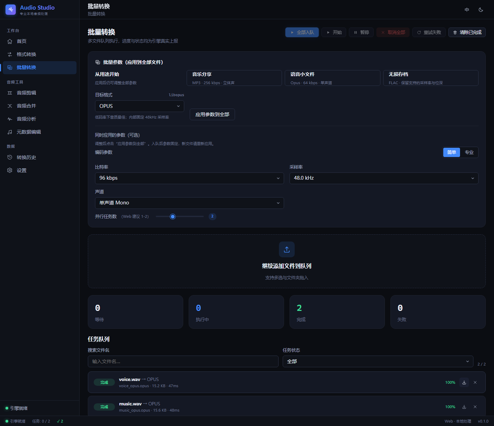
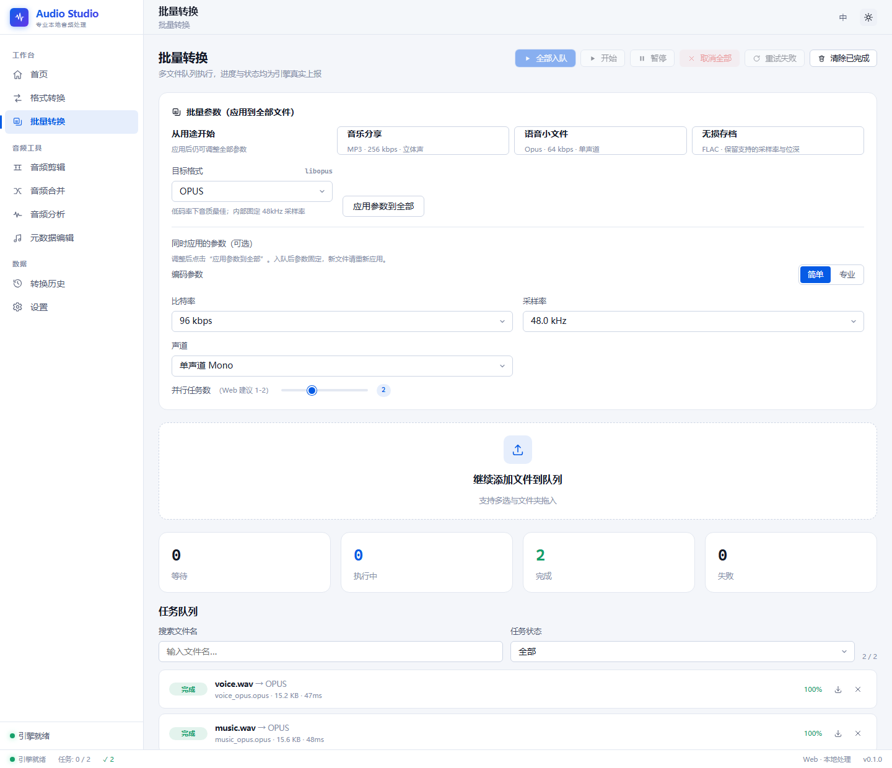

# Audio Studio 本轮升级记录（2026-11-13）

> 历史实施快照：下文记录本次平台收敛前的检查过程。随后已按用户确认移除 Android 工程和相关构建配置，并清理旧审计报告与过程缓存；当前只维护 Windows / Web。当前版本日志见 [更新日志](releases/release-notes.md)，清理结果见 [文件管理说明](REPOSITORY_HYGIENE.md)。下文的旧目录、缓存路径和待办不再作为当前维护要求。

基线：`main` / `d554a52`，工作区干净。只修改当前项目，不提交、不推送、不发布。

## 验收清单

- [x] 阅读项目入口、共享规则、Web/桌面引擎、Android 队列与持久化、现有报告和 CI。
- [x] 复核至少 5 个开源参考项目的文档、核心源码和许可证。
- [x] P0：修复全部开始、准备阶段取消、队列失败后继续执行和任务参数快照。
- [x] P1：修复批量参数显示，增加可编辑的用途预设。
- [x] P2：增加文件名搜索和状态筛选，验证窄屏布局；控件使用原生按钮/表单语义，完整键盘与读屏审计仍待补充。
- [x] 运行回归、类型、Lint、格式和两种前端构建；执行真实浏览器转换。
- [x] 同步 README、变更记录、竞品对照、验证结果和后续建议。

## 设计约束

保持本地优先和现有导航。沿用石墨背景 `#0b0d12`、面板 `#141824`、正文 `#e8ecf5`、次级文字 `#a3adc2` 与现有蓝色操作色。沿用系统中文字体和既有字号、间距 token。布局围绕“用途 → 可编辑参数 → 导入 → 队列”，预设横向排列并在窄屏换行，搜索/筛选紧邻任务列表。不添加云服务、登录或新依赖，不复制 GPL 源码。

## 基线验证

首次 `pnpm test`：共享核心 74 PASS / 20 SKIP（系统 FFmpeg/FFprobe 不在 PATH）；Web BLOCKED，应用的 `node_modules` 中依赖目录为空。将原 Web 依赖目录保留在项目 `.vitest-tmp/web-deps-before-repair`，按原锁文件重装成功，未修改依赖声明。

## 项目分析与功能地图

Audio Studio 是 MIT 许可、本地优先的音频转换与常见处理工具，当前版本为 `0.1.0`，不是完整多轨工作站。无服务端、账户系统或云数据库。

| 模块 | 实际入口与数据路径 | 本轮证据与边界 |
|---|---|---|
| Web / Windows UI | React 18 + Vite 5；`main.tsx → App.tsx → Shell / pages`；hash 导航 | 同一 React UI；Windows 运行时使用 Tauri API，Android 有独立 UI |
| 格式与参数 | `packages/shared/src/{formats,params,args,validation,plan}.ts` | 13 种登记格式；实际输出能力来自引擎探测，不能以登记数等同全部可用 |
| 转换/批量 | `ConvertPage / BatchPage → session → AudioEngine.run` | 真正任务状态机、并发、进度、取消、结果下载；本轮重点修复 |
| 剪辑/合并 | `ClipPage / MergePage → runAdhoc → args → engine` | 合并间隔、逐段淡出已实际采样验证；本轮没有验收所有剪辑模式 |
| 分析/标签 | `AnalyzePage / MetadataPage → probe / FFmpeg` | 实际流、标签和封面读写路径存在；桌面自定义封面上传在现有代码中禁用，不能宣称全端等效 |
| 历史/设置 | `history.ts` 的 IndexedDB；`settings.ts` 的 localStorage 与内存后备 | 浏览器刷新后保留 9 条本轮真实任务记录；没有持久保存转换文件内容 |
| 浏览器音频 | `WasmFfmpegEngine / loadFfmpeg`，Worker 池和内存文件系统 | 使用本地 wasm 内核；本轮 MP3、Opus、FLAC 和 WAV 合并完成真实浏览器验收 |
| Windows 音频 | `NativeEngine → invoke/listen → Rust commands / engine / safety` | 原生进程参数、路径防护与输出重命名；适配器测试及 Rust 回归通过，未运行完整安装器 |
| Android | Kotlin + Compose，`ConvertManager → FfmpegEngine → SAF/MediaStore`，JSON 任务记录、设置 | 规则是 Kotlin 实现而非运行 TypeScript；本轮参数构建同步，Gradle 下载阻塞测试 |
| 更新/发布 | `updates.ts`、`UpdateChecker.kt`、Tauri 插件、CI/Release workflows | 既有更新代码；本轮只修正 desktop 构建命令，没有发布、安装或升级链路证明 |

阅读了 README、历史报告、根/子包清单、Vite/Vitest/ESLint 配置、共享格式/参数/状态机、session、转换/批量/合并/分析/标签/历史入口、双引擎及 Rust 路径安全、Android 队列/参数/持久化和发布入口。没有把文档中的能力描述当作全部功能实测通过。

## 开源研究：来源与取舍

研究日期：2026-11-13。使用联网搜索与上游原始源码，未下载执行外部项目代码。GitHub 匿名 API 返回 403 配额限制，因此改用公开页面、官方文档和 raw 源码；不报告未经验证的最新 star 数、release 日期或所有 issue 的状态。Audacity 使用明确固定的 3.x 源码提交，当前主分支正在进行 4.x 结构调整，不能把旧导出界面当作 4.x 的现状。

| 项目与许可证 | 实际深入阅读的证据 | 提炼与落地 |
|---|---|---|
| [fre:ac](https://github.com/enzo1982/freac)，源文件声明 GPL-2.0-or-later | [Readme](https://github.com/enzo1982/freac/blob/master/Readme)、[joblist.cpp](https://github.com/enzo1982/freac/blob/master/src/joblist.cpp)：添加/删除轨道、任务列表事件连接/断开、拖放入口 | 把导入、列表操作和转换调度作为相互协调的流程。本地修复同批去重、默认码率、队列操作与并发槽位，不移植 C++ 实现 |
| [HandBrake](https://github.com/HandBrake/HandBrake)，发布构建 GPLv2；文件许可有差异 | [队列文档](https://handbrake.fr/docs/en/latest/advanced/queue.html)、[预设文档](https://handbrake.fr/docs/en/latest/technical/official-presets.html)、[QueueViewModel.cs](https://github.com/HandBrake/HandBrake/blob/master/win/CS/HandBrakeWPF/ViewModels/QueueViewModel.cs)：暂停、任务状态约束、重试命令与编辑工作流；[许可证](https://github.com/HandBrake/HandBrake/blob/master/LICENSE) | 从用途选择参数、允许继续编辑，并区分任务配置与调度。本地新增三种音频用途预设与入队快照；不引入视频预设或 GPL 代码 |
| [FFmpeg.wasm](https://github.com/ffmpegwasm/ffmpeg.wasm)，wrapper MIT；核心/codec 许可另计 | [README](https://github.com/ffmpegwasm/ffmpeg.wasm#readme)、[classes.ts](https://github.com/ffmpegwasm/ffmpeg.wasm/blob/main/packages/ffmpeg/src/classes.ts)：请求 Promise、Worker、`terminate()` 拒绝未完成调用、重载要求与进度精度限制；[许可](https://github.com/ffmpegwasm/ffmpeg.wasm/blob/main/LICENSE) | 取消是异步资源回收，不能只删除 UI 行。本地使用执行集合限制实际占用的并发槽位，在所有退出路径释放，准备期间检查取消意图；保留既有真实 Worker 终止机制 |
| [LosslessCut](https://github.com/mifi/lossless-cut)，仓库 LICENSE 为 GPLv2，具体文件以声明为准 | [功能文档](https://github.com/mifi/lossless-cut/blob/master/docs/features.md)、[ExportConfirm.tsx](https://github.com/mifi/lossless-cut/blob/master/src/renderer/src/components/ExportConfirm.tsx)：不同导出模式的解释、元数据策略、明确确认行为；[许可](https://github.com/mifi/lossless-cut/blob/master/LICENSE) | 显式呈现设置的作用范围与导出行为。本地说明预设、批量应用、入队后参数固定，以及筛选只影响显示；不移植 Electron 工作台 |
| [Audacity](https://github.com/audacity/audacity)，项目 GPLv3、多数代码 GPLv2-or-later | [当前 README 与许可](https://github.com/audacity/audacity#license)、固定提交的 [ExportAudioDialog.cpp](https://github.com/audacity/audacity/blob/4bf0942a089448c7d62dfc467fb58de55992f3fe/au3/src/export/ExportAudioDialog.cpp)：默认采样率、导出格式/范围、条件禁用、命名与覆盖选项 | 参数应在界面中反映真实配置、合理保留源属性。本地修复批量控件回跳、保留支持的 FLAC 位深，并在没有逐段时长时拒绝错误淡出；不增加多轨录音功能 |

五个项目的设计原则用于自主实现。没有复制、移植或引入 GPL 源码，也没有增加产品运行依赖；现有 FFmpeg core 的分发许可需按实际构建持续审查。

| 对比维度 | 本地原有情况 | 上游可参考实践 | 本轮应用 / 后续方向 |
|---|---|---|---|
| 核心功能 | 转换/合并均存在，但队列/片段顺序有缺陷 | fre:ac 的队列流程；LosslessCut 的明确导出语义 | 修复真实操作与真实输出；不重复建立转换器 |
| UI 设计 | 已有主题 token、侧栏、参数面板 | Audacity 按导出任务组织配置 | 预设紧邻参数、搜索紧邻队列；沿用视觉体系 |
| 用户体验 | 批量控件回跳，新文件“开始全部”无效 | 用途预设与可编辑参数、显式任务状态 | 预设、手动应用、状态搜索和窄屏可读任务行 |
| 技术架构 | 共享 TS、Kotlin 移植、原生适配层 | FFmpeg.wasm 的 Worker/Promise 生命周期 | 任务快照、必经 finally、先订阅再启动；未更换框架 |
| 自动化能力 | 既有 CI 与单元测试 | 成熟队列的重试/暂停；官方预设降低重复输入 | 修复重试/开始，增加真实音频浏览器验收脚本 |
| 扩展能力 | 已有 AudioEngine 与注册表 | fre:ac 的模块边界、HandBrake 的配置分离 | 预设留在共享纯逻辑；以后增预设不必改队列或 FFmpeg 内核 |

## 本轮实施与优先级

| 优先级 | 已实施问题 / 升级 | 用户收益与风险控制 |
|---|---|---|
| P0 | “开始全部”为尚未入队的文件创建任务；已有完成任务不重复执行；运行中不重复启动同一文件 | 修复主操作失效及重复转换；现有逐文件启动保留 |
| P0 | 统一释放准备/校验/执行路径的并发槽位；删除任务仍计入实际执行数直到引擎退出 | 一项失败不堵塞队列，清空后添加新任务仍遵守并发上限 |
| P0 | 准备时暂停/取消/移除，在初始化结束后阻止提交到引擎；初始化失败向所有等待者传播 | 防止取消后继续转换，失败允许重试；运行完成瞬间仍以真实结果为准 |
| P0 | 入队深拷贝编码配置；执行读取 task.params；修复重试计次与旧状态；探测不覆盖已编辑参数 | 等待时编辑其他文件不会漂移已有任务参数；UI 明示快照语义 |
| P0 | 静音片段交错拼接；时间戳重置为零；逐段淡出使用该片段时长 | 修复静音在末尾和多段从起点淡出的音频错误；缺时长明确失败而不交付错误结果 |
| P0 | 原生适配器先等待全部事件订阅，再启动进程；失败清理订阅；校验实际重命名输出 | 短任务不丢失完成事件，输出冲突后检查正确文件 |
| P0 | 修复 `pnpm build:desktop-ui` 的多余 `--` | 从日志证实由 `building for production` 改为 `building for desktop`，CI/Release 复用该命令 |
| P1 | 三种用途预设；源位深感知 FLAC；能力不支持时禁用对应预设 | 减少重复配置；仍能编辑参数；不自动启用未经本轮完整验收的归一化 |
| P1 | 批量草稿保持真实值，手动调整后显式“应用参数到全部”；切换格式清除旧编码器参数 | 避免控件显示和任务配置不一致；新导入文件需重新应用，界面已提示 |
| P1 | 同次导入去重与合法默认码率；合并的采样率/声道限制到目标支持集合 | 减少重复工作及 Opus 使用 44.1kHz 等不兼容参数 |
| P2 | 文件名搜索、状态交集筛选、无匹配空态；窄屏任务名独占更宽一行 | 大队列可定位，390px 下不会把文件名挤成单字；统计和全局操作保持全队列范围 |
| P2 | 可复现真实音频验收脚本、截图；ESLint 忽略测试临时目录/覆盖率产物 | 避免把生成代码当项目源码检查，测试不依赖个人音频文件 |

没有数据库迁移、API 破坏性变更或依赖升级。新增 `itemDurationsMs` 是可选上下文字段；Android 构建器同步该字段。针对逐段淡出，由旧的错误静默行为改为缺少时长时明确拒绝。Android 预设 UI 尚未实现，不能把 Web/桌面新增能力说成三端均已交付。

## 文件修改清单

| 文件 | 变更原因 |
|---|---|
| `packages/shared/src/presets.ts`、`index.ts` | 新增纯逻辑预设并导出 |
| `packages/shared/src/args.ts` | 合并顺序、时间戳、逐段淡出上下文 |
| `apps/web/src/stores/session.ts` | 调度、取消、快照、初始化错误、导入/参数一致性 |
| `apps/web/src/engine/{WasmFfmpegEngine,NativeEngine}.ts` | 逐段时长、目标参数解析、原生 listener 和实际输出校验 |
| `apps/web/src/components/{PresetPicker,TaskRow}.tsx` | 用途入口、实际能力约束、窄屏任务行语义 class |
| `apps/web/src/pages/{BatchPage,ConvertPage}.tsx` | 控制参数、显式应用、开始全部入口、搜索/筛选 |
| `apps/web/src/styles/components.css` | 基于现有 token 的预设/筛选布局及任务行响应式 |
| `apps/android/.../engine/Args.kt` | 同步正确间隔、时间戳、淡出时长规则 |
| `packages/shared/src/__tests__/{args,presets}.test.ts` | 核对参数、片段顺序、未知时长边界、预设不污染源对象 |
| `apps/web/src/__tests__/{session,NativeEngine,BatchPage}.test.*` | 异步竞态、资源回收、事件订阅、实际控件交互回归 |
| `apps/android/.../MergeArgsTest.kt` | 新增 Android 合并规则回归；本轮未执行成功 |
| `apps/web/scripts/e2e-audio.py` | 可重复生成合成音频并真实操作浏览器、下载、采样验收 |
| `package.json`、`eslint.config.mjs` | 正确传递 desktop 模式，排除生成检查产物 |
| `README.md`、`docs/releases/release-notes.md`、本报告、三个历史报告入口 | 功能/工作流/测试/研究同步，历史记录保留 |
| `docs/screenshots/*.png` | 四张真实运行截图：桌面、浅色、手机参数、手机队列 |

删除产品文件、用户数据、配置或历史：无。未修改锁文件、数据库结构或远程仓库。

## 验证结果

| 命令 / 场景 | 结果 | 实际证据与限制 |
|---|---|---|
| `pnpm install --frozen-lockfile`（恢复空目录后） | PASS | 按原锁文件恢复 Web 依赖并复制 wasm 内核；旧目录保留，未更新依赖 |
| `pnpm typecheck` | PASS | shared / Web TypeScript 均通过 |
| `pnpm lint` | PASS | 初次把本轮备份的生成文件当源码检查失败；添加标准生成目录忽略后通过 |
| `pnpm format:check` | PASS | 新修改按现有规则格式化后通过 |
| `pnpm test`：shared | PARTIAL | 81 PASS；20 个系统 FFmpeg/FFprobe 集成测试因工具不在 PATH 而 SKIP，不能算通过 |
| `pnpm test`：Web | PASS | 131 项；包含 33 个 session、5 个 NativeEngine、3 个 BatchPage 测试 |
| `pnpm build:web` | PASS | Vite production 模式；两条既有静态/动态混合导入警告保留 |
| `pnpm build:desktop-ui` | PASS | Vite desktop 模式；两条相同导入警告保留，未制作 MSI/NSIS |
| `cargo test --locked --offline` | PASS / PARTIAL | 45 项返回通过；有真实 FFmpeg 条件早退用例，不能视为原生音频转换已验收 |
| `py -3.14 apps/web/scripts/e2e-audio.py` | PASS | Playwright Chromium，真实 wasm 与合成音频，无业务 mock，见下文 |
| `apps/android/gradlew.bat testDebugUnitTest --no-daemon --console=plain` | BLOCKED | Gradle 9.8.2 分发下载长期无有效字节，终止本轮等待；新增 Kotlin 测试未执行，未用旧 Gradle 冒充 |
| Android APK / 设备、Windows 安装器/更新、其他浏览器、完整键盘/读屏、安全渗透/性能基准 | BLOCKED / PARTIAL | 未覆盖；不根据单测或构建宣称这些场景通过 |
| `git diff --check` | PASS | 无补丁空白错误；仓库保留本轮未提交修改 |

浏览器工具说明：宿主浏览器组件缺少所需的服务模块。系统默认 Python 的 Playwright 安装又因 TLS 失败而未完成；最终使用本机已有的 Python 3.14 + Playwright + Chromium 成功验收，不修改全局安装。中间一次测试脚本因已删除 toast 的索引失效、一次受通知遮挡/开发热更新影响而失败，修复测试定位和截图时序后最终完整运行通过，未弱化产品断言。

真实浏览器验收包括：

- 两个合成 WAV 从转换页“开始全部”执行，MP3 下载为 25,748 字节。
- 音乐分享预设实际执行；语音预设改为 96 kbps 后执行，Opus 文件 15,514 字节，检查 OggS / OpusHead 与单声道标记。
- FLAC 文件 21,230 字节，STREAMINFO 验证源采样率 44,100 Hz、16-bit 和 44,100 个采样点保留。
- 队列搜索大小写、状态交集、空态和控制值保持；390px 宽度无页面/主工作区横向溢出，任务名宽度大于 150px；窄屏菜单和中英文切换可操作。
- 两段各 1 秒音频合并，间隔 500ms，第二段末尾淡出 300ms：输出 2.5 秒、44.1kHz，间隔 RMS = 0，第二段起始 RMS ≈ 8484.84，末尾 RMS ≈ 908.66，验证静音位置与淡出方向。
- 9 条实际任务记录在页面刷新后仍从 IndexedDB 读出；页面脚本错误为 0。

结果 JSON 与合成文件位于 `.vitest-tmp/e2e-audio/`。端口 5187 仅用于本轮测试，本轮结束时停止自己启动的开发服务；没有关闭用户已有进程。

## 真实截图

手机截图：[参数布局](screenshots/batch-mobile.png)、[任务列表](screenshots/batch-mobile-queue.png)。截图均使用本轮合成音频，非个人资料或设计稿。

## 后续升级与仍未解决的问题

| 优先级 | 事项 | 价值、难度与暂不纳入原因 |
|---|---|---|
| P1 | 归一化一致性 | Web 合并的测量入口仍只测第一个源；NativeEngine 没有完整两遍测量上下文。需要独立实现与测量后处理、取消、静音/无限测量值等验收，不能当作本轮已解决。三个新预设均不启用归一化 |
| P1 | Android 规则与完整功能的真实构建/设备验证 | 下载可用后先运行新增合并回归，再验 APK、SAF 权限、后台长任务；本轮没有伪称 Kotlin 通过 |
| P1 | Windows 原生格式/短任务/取消及签名升级安装验收 | 适配器 mock 测试不能替代 Tauri + 系统 FFmpeg + 安装器；需要合适的本地 FFmpeg 和真实发行资产，不发布测试包冒充 |
| P2 | 大文件资源与导入调度 | 现有导入可并发发起许多 probe；池创建等待期间的预留/排队、大文件缓存和内存峰值应做独立压力测试。未依据 1 秒样本宣称性能提升 |
| P2 | 其他页面窄屏/无障碍、桌面自定义封面、剪辑取消细节 | 本轮只完成新增工作台真实布局验收；还需逐页测试和平台适配，不将 Web 可用等同三端等效 |
| P2 | 动态/静态混合导入警告 | 运行无阻断，修整拆包应先核对引擎初始化依赖；避免为消除警告大范围重构 |
| P3 | 用户自定义预设、恢复会话、诊断包、Android 用途 UI | 有实际收益，但要定义版本化持久化、源文件重新授权/定位与日志脱敏；不强加新数据库、云同步或插件市场 |

安全方面保留本地音频处理、参数数组调用、不覆盖源文件、输出重命名与路径校验；本轮新增的是配置隔离与失败后资源清理。没有运行依赖全生态漏洞扫描、二进制暴露审计或渗透测试，不能据此承诺全面安全。未执行任何远程写入、账号变更或秘密管理操作。

## 完成度与交付边界

本轮选定的 P0/P1/P2 增量实现和可用环境下的验收已完成；Android 验证受外部下载阻塞。以下为基于证据的工程成熟度判断，非统计度量：5 分代表跨平台与生产交付证据齐全；3 分代表核心可用但仍有重要验证缺口；2 分代表证据较有限。

| 维度 | 评分 / 5 | 依据 |
|---|---:|---|
| 功能完整度 | 3 | 核心转换和本轮合并有真实输出；归一化与跨端高级功能仍有缺口 |
| UI/UX 成熟度 | 3 | 工作台深浅主题、390px、双语实际检查；其他页面与完整无障碍矩阵未完成 |
| 代码质量 | 4 | TS 类型/Lint/格式、共享/Web 回归和 Rust 测试通过；Kotlin 未完成编译验收 |
| 性能 | 2 | 没有大文件、真实移动设备的 CPU/内存与冷启动基准；只验证短合成样本 |
| 安全性 | 3 | 沿用源文件保护与路径校验，无新服务/产品依赖；未做供应链全审计和渗透验证 |
| 稳定性 | 3 | 调度竞态回归及浏览器真实流程通过；设备后台与安装升级未验收 |
| 可维护性 | 4 | 预设纯逻辑、共享参数构造、明确状态机、可复现脚本和文档；仍有 Kotlin 规则同步成本 |
| 扩展性 | 3 | 可扩展格式/预设/引擎；没有经过版本兼容验证的自定义预设或插件协议 |

工作只存在于当前项目本地，未提交、推送、合并、发布或部署。测试依赖备份保留在 `.vitest-tmp/web-deps-before-repair`。没有删除原有功能、用户配置或历史记录。
